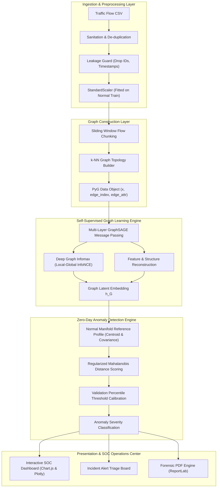

# System Architecture & Technical Specification

## Zero-Day GraphIDS
**A Self-Supervised Graph Learning Framework for Intelligent Zero-Day Malicious Traffic Detection**

---

## 1. Architectural Philosophy

Traditional Network Intrusion Detection Systems (NIDS) are hamstrung by their reliance on known attack signatures or labeled supervised classifiers. When an adversary deploys a novel **Zero-Day exploit**, supervised systems fail because the exploit pattern does not exist in their training distribution.

Zero-Day GraphIDS solves this through three foundational tenets:
1. **Self-Supervised Learning (SSL)**: Optimization strictly learns the distribution of normal, benign traffic without requiring any attack labels during representation learning.
2. **Graph-Structural Traffic Modeling**: Rather than evaluating isolated tabular rows, network flows are modeled as topological chunks using **$k$-Nearest Neighbors ($k$-NN) similarity graphs**.
3. **Adaptive Mahalanobis Threshold Calibration**: Latent representations of unseen traffic are mapped against the normal reference profile; chunks deviating beyond numerically regularized decision boundaries are flagged as Zero-Day anomalies.

---

## 2. High-Level System Architecture

---

## 3. Module Breakdown & Four-Member Engineering Division

| Module | Team Member | Scope & Owned Components | Key Source Files |
|---|---|---|---|
| **Member 1** | Full-Stack & SOC Lead | Django backend, RBAC, authentication, SOC dashboard, responsive dark UI, and system status. | `accounts/`, `dashboard/`, `config/`, `templates/`, `static/` |
| **Member 2** | Data Pipeline Lead | Dataset ingestion, file validation, schema detection (CIC-IDS2017, CTU-13, USTC-TFC2016), data leakage prevention, and tabular preprocessing. | `datasets/`, `datasets/preprocessing.py`, `datasets/validators.py` |
| **Member 3** | GNN & Deep Learning Specialist | Graph construction ($k$-NN metric proximity), GraphSAGE/GCN message passing, self-supervised InfoNCE & reconstruction loss, and embedding extraction. | `ml_engine/`, `ml_engine/encoder.py`, `ml_engine/self_supervised.py`, `training/trainer.py` |
| **Member 4** | Cybersecurity & Evaluation Specialist | Anomaly scoring (Mahalanobis with Ledoit-Wolf shrinkage), threshold calibration, leave-one-attack-family-out evaluation, baselines (Isolation Forest), SOC alerts, and ReportLab PDF forensic generation. | `detection/`, `training/evaluation.py`, `reports/`, `reports/report_generator.py` |

---

## 4. Mathematical Formulations

### 4.1 Graph Message Passing (GraphSAGE)
For node $v \in \mathcal{V}$ at layer $k$:
$$h_{\mathcal{N}(v)}^{(k)} = \text{AGGREGATE}_k \left( \left\{ h_u^{(k-1)}, \forall u \in \mathcal{N}(v) \right\} \right)$$
$$h_v^{(k)} = \sigma \left( W^{(k)} \cdot \left[ h_v^{(k-1)} \,\|\, h_{\mathcal{N}(v)}^{(k)} \right] \right)$$

### 4.2 Graph Summary Readout
To form a fixed-size representation of the graph chunk:
$$h_G = \left[ \frac{1}{|\mathcal{V}|} \sum_{v \in \mathcal{V}} h_v^{(K)} \,\|\, \max_{v \in \mathcal{V}} h_v^{(K)} \right] \in \mathbb{R}^{2 \cdot D_{\text{embed}}}$$

### 4.3 Composite Self-Supervised Objective
Optimization minimizes feature reconstruction error while maximizing local-global mutual information:
$$\mathcal{L}_{\text{total}} = \frac{1}{|\mathcal{V}|} \sum_{v \in \mathcal{V}} \|x_v - \hat{x}_v\|_2^2 + \lambda \mathcal{L}_{\text{DGI}}$$
Where:
$$\mathcal{L}_{\text{DGI}} = - \frac{1}{2N} \left[ \sum_{i=1}^N \log \mathcal{D}(h_i, s) + \sum_{j=1}^N \log \left(1 - \mathcal{D}(\tilde{h}_j, s)\right) \right]$$

### 4.4 Regularized Mahalanobis Anomaly Distance
With empirical centroid $\mu$ and regularized covariance $\Sigma_{\text{reg}} = \Sigma + \epsilon I$:
$$D_M(h_G) = \sqrt{(h_G - \mu)^T \Sigma_{\text{reg}}^{-1} (h_G - \mu)}$$
Anomalous condition:
$$\text{Verdict}(h_G) = \begin{cases} \text{MALICIOUS / ZERO-DAY}, & \text{if } D_M(h_G) > \tau_{\text{calibrated}} \\ \text{NORMAL BASELINE}, & \text{otherwise} \end{cases}$$
